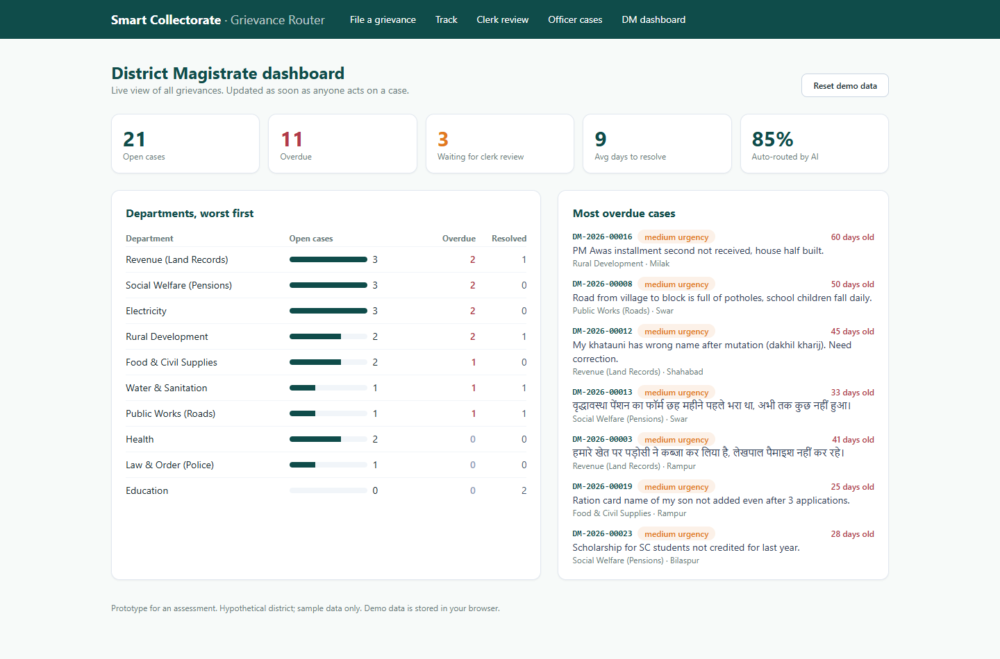
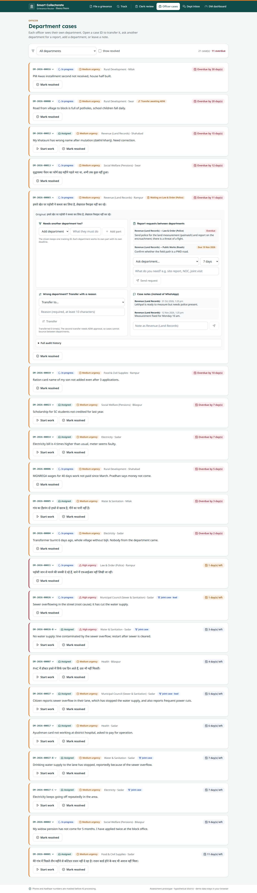

# Grievance Router: Smart Collectorate prototype

**Live demo:** https://smart-collectorate-grievance-router.vercel.app

A working proof for one use case from the **Smart Collectorate** proposal (Creditfix Group, AI Engineer assessment).
A citizen files a grievance in Hindi, English or Hinglish. The system gives it a tracking number, and AI suggests the
department, urgency and a one-line summary. **A person checks anything the AI is unsure about.**



## What it shows

| Screen | Who | What it does |
|---|---|---|
| `/submit` | Citizen | File a grievance and get a tracking ID, department, urgency and deadline at once |
| `/track` | Citizen | Check status by tracking ID (in production this would also go out by SMS and WhatsApp) |
| `/review` | Clerk | Cases where the AI was under 70% sure. The clerk confirms or corrects, and confirms any split into a joint case; every decision is logged |
| `/cases` | Officer | Department queue sorted by deadline. Open a case to transfer it, request a report from another department, add a department, or leave a note |
| `/inbox` | Department | Report requests from other departments (reply with a deadline), joint cases, and DM circulars to acknowledge |
| `/dashboard` | DM / ADM | Open, overdue, waiting on another department, joint cases, auto-routed %; ADM approval of second transfers; circulars with read receipts |

## Internal communication between departments

Delays in a Collectorate are mostly *between* departments, so the hand-offs live inside the case instead of on letters, phone calls and WhatsApp:

- **One complaint, several problems → joint case.** The AI returns the main (root-cause) department plus `also: [...]` for other problems. The citizen keeps one tracking ID (`DM-2026-00026`); each department gets its own part (`-B`, `-C`) with its own deadline. The citizen's track page shows every part.
- **Transfer with a reason.** The first transfer happens at once; a **second transfer needs ADM approval**, so a case cannot bounce between departments.
- **Report requests.** Revenue can ask Police for a site report with a deadline. It shows in the Police inbox, turns red when overdue, and the dashboard shows which department is holding others up.
- **Case notes** replace WhatsApp messages, and **DM circulars** show who has acknowledged them.
- Every action is written to the case's audit history.



## How the AI step works (`lib/classify.ts`)

1. **Mask personal data first** (`lib/mask.ts`). Aadhaar, mobile numbers and emails become `[AADHAAR]`, `[PHONE]` and `[EMAIL]` before any text leaves the server.
2. **Ask the LLM for strict JSON.** The prompt lists a **fixed set of departments** with examples, defines urgency and asks for an honest confidence score.
3. **Validate the answer.** If the department is not on the list, it becomes `OTHER` and confidence is capped. Confidence is clamped to 0–1, and an unknown urgency defaults to medium.
4. **Human in the loop.** If confidence is below `0.7` or the department is `OTHER`, the case goes to `needs_review` instead of being routed automatically.
5. **Fallback.** If there is no API key, the AI times out or the answer can't be parsed, a Hindi/English keyword classifier (`lib/keyword.ts`) takes over and the case is sent for review. The office never stops because the AI is down.

The AI only **suggests**. It never closes, rejects or replies to a case.

### Where AI is used and where it isn't

- **LLM:** understanding free-text Hindi, English and Hinglish, picking a department and urgency, writing a neutral one-line summary, extracting location and scheme.
- **Plain code:** tracking IDs, deadlines (SLA days per department), status changes, the audit trail, dashboards. Rules are cheaper, predictable and easy to audit.

## Run it

```bash
npm install
cp .env.example .env.local      # optional: add ONE API key
npm run dev                     # http://localhost:3000
```

Supported providers (plain `fetch`, no SDKs):

| Env var | Default model |
|---|---|
| `ANTHROPIC_API_KEY` | `claude-sonnet-5-5` |
| `OPENAI_API_KEY` | `gpt-4o-mini` |
| `GEMINI_API_KEY` | `gemini-2.5-flash` |

Use `LLM_PROVIDER` to force a provider and `LLM_MODEL` to override the model. **With no key, the app runs on the keyword fallback,** so the demo always works.

## Evaluation

`eval/cases.json` holds 22 labelled grievances: Hindi, English and Hinglish, including vague cases and 3 complaints with several problems (joint cases).

```bash
python eval/run_eval.py http://localhost:3000
```

A case counts as correct if it is auto-routed to the right department, or sent to human review when it is vague. A joint case is correct only if the main department plus the extra departments are exactly right.

| Engine | Correct | Auto-routed | **Wrongly auto-routed** |
|---|---|---|---|
| Keyword fallback (no AI) | 19 / 22 (86%) | 15 / 22 | **0** |
| LLM (Claude Sonnet 5.5) | **22 / 22 (100%)** | 19 / 22 | **0** |

"Wrongly auto-routed" is the metric that matters most: a wrong department wastes days. A case sent to review only costs a clerk a few seconds.

## Design decisions

- **Next.js (App Router) + TypeScript.** One codebase for the UI and the API route, and easy to deploy.
- **Demo data lives in the browser (`localStorage`)**, seeded with 26 realistic cases (including a joint case, an overdue report request and a transfer waiting for ADM approval), so there is no database to set up. Use "Reset demo data" on the dashboard to start over.
- **The department list and SLA days** (`lib/departments.ts`) are assumptions. In the real project they are agreed with the office during discovery.
- **The keyword classifier matches whole words,** so "जल" (water) does not match inside "बिजली" (electricity), and "fir" does not match "first".

## What production would add

- PostgreSQL with an **append-only audit table**, an object store for scanned documents, and hosting on NIC or a MeitY-empanelled cloud in India.
- OTP login and role-based access (citizen, clerk, officer, DM). Officers see only their own department.
- WhatsApp Business API and an SMS gateway for intake and status updates. Bhashini for speech and translation.
- A connector that pushes cases into CPGRAMS or the state IGRS portal, so this tool fills gaps instead of replacing those systems.
- Monthly accuracy and bias review using the clerk corrections that are already logged.

---
Hypothetical case study. All names and grievances are made up.

## Presentation

The proposal deck is in [`presentation/`](presentation/) (PPTX and PDF).
